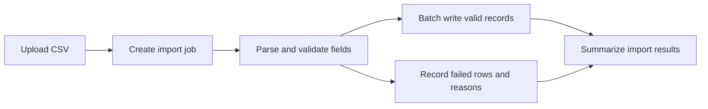

[中文](README.md) | [English](README.en.md)

# my-skills

A collection of general-purpose skills for AI agents, providing task workflows and execution rules that can be installed as needed and used independently.

## Installation

With `npx`:

```bash
npx skills add KomeijiReimu/my-skills
```

With `bunx`:

```bash
bunx skills add KomeijiReimu/my-skills
```

Install a single skill:

```bash
npx skills add KomeijiReimu/my-skills --skill create-readme
npx skills add KomeijiReimu/my-skills --skill fkgpt-output-quality
```

Source: [`KomeijiReimu/my-skills`](https://github.com/KomeijiReimu/my-skills)

After installation, name the skill in a supporting agent, for example:

> Use create-readme to rewrite this project's README, covering every user-facing feature, installation, and typical usage.

## Choose by task

### Output control

| Skill | Purpose and workflow |
| --- | --- |
| [`fkgpt-output-quality`](fkgpt-output-quality/SKILL.md) | Control prose in chat replies, progress updates, and document files. Drafting constraints and a simulated pre-send hook remove straw-man rebuttals, irrelevant caveats, invented jargon, and unnecessary process; noncompliant drafts require correction before delivery. |

The agent executes the skill after loading it; instructions simulate the pre-send check.

#### Dedicated document-writing improvements

The following 4 documentation skills include prose constraints for clear, complete human-facing documents:

- **Concrete language.** Clear subjects, actions, and facts replace invented jargon such as “evidence gates” and “semantic closure.” Established technical terms receive explanations when useful.
- **Less defensive prose.** Remove baseless negations, straw-man rebuttals, irrelevant caveats, and empty self-praise while retaining limitations and risks that affect understanding or use.
- **Standalone final text.** Organize around reader questions and remove chat replies, revision notes, and accounts of the writing process.
- **Complete content.** READMEs cover features and usage, technical documents explain implementation, and translations preserve the original information and meaning.
- **Corrections in the document.** Deliver the revised text, with identified problems addressed in the file.
- **Renderable formulas.** Markdown math uses LaTeX: `$...$` inline and standalone `$$...$$` blocks for display equations.

### Human-facing document creation and editing

| Skill | When to use it | Deliverable |
| --- | --- | --- |
| [`create-readme`](create-readme/SKILL.md) | Create or rewrite a project homepage covering every verified user-facing feature and essential usage point. | `README.md`: purpose, features, installation, quick start, typical usage, configuration, and important limitations. |
| [`deliverable-document-writer`](deliverable-document-writer/SKILL.md) | Turn notes, drafts, or review material into a document ready to submit or share. | A standalone report, proposal, or complete chapter connecting facts, evidence, and conclusions. |
| [`project-documentation-generator`](project-documentation-generator/SKILL.md) | Read the repository and explain feature implementation, module interactions, and key code paths. | System-level technical documentation with implementation details, runtime configuration, and Mermaid diagrams; a default filename is `PROJECT_FULL_DOCUMENTATION.md`. |
| [`paper-reader`](paper-reader/SKILL.md) | Process batches of readable papers through completion, producing sentence-by-sentence Chinese translations, detailed Chinese analyses, or both. | Separate translation and/or analysis files per paper; faithful translations cover sections, figures, formulas, and appendices. |

### Long-running work and context management

| Skill | When to use it | Output and usage boundaries |
| --- | --- | --- |
| [`project-context`](project-context/SKILL.md) | Maintain Chinese working context for subsequent agents on long-running projects, with creation, updates, takeover, rebuilding, and auditing. | 10 core context files in `.agent-context/` for continuity across sessions; maintenance requires explicit user authorization in the current request. |

### Development collaboration

| Skill | Purpose |
| --- | --- |
| [`git-commit`](git-commit/SKILL.md) | Inspect the actual diff, stage logical changes, generate a Conventional Commits subject and body, and commit. |

## Structure and content examples

The following examples use a fictional checksum tool, import service, and paper excerpts to illustrate each skill's content structure and writing style.

### create-readme: a project homepage with complete feature and usage coverage

Organize the README around adoption and usage, with all actual features represented. A CLI project might use:

```text
Project name and one-sentence purpose
├── Features: inputs, outputs, supported operations
├── Requirements and installation
├── Quick start: shortest command and expected result
├── Typical usage by real use case
├── Configuration and options
├── Important limitations and data handling
└── Links to deeper documentation
```

**Example excerpt:**

> **Hashdir** creates SHA-256 manifests for directory contents so you can check backup integrity.
>
> **Features**
> - Scan a directory recursively and hash each file.
> - Save a manifest for later checks.
> - Compare manifests to identify added, removed, and changed files.
>
> **Quick start**
> With Python 3.10+, run `python hashdir.py ./photos --output checksums.json` to save relative paths and hashes.
>
> **Check a backup**
> Run `python hashdir.py ./restored --compare checksums.json` to find files that differ from the original manifest.

### deliverable-document-writer: source material becomes a submission-ready document

Choose sections for the report, proposal, or paper's reader tasks. When a draft exists, preserve its structure, register, and depth of argument. A release-scope decision document might use:

```text
Objective and conclusion
├── Background and problem
├── Facts and evidence
├── Options and selection rationale
├── Implementation and responsibilities
└── Risks, open decisions, and acceptance criteria
```

**Example excerpt:**

> **Release scope**
>
> This release delivers batch export and failed-task retries. Batch export replaces individual downloads. Retries reuse recorded task state so users can resume from the failure point.
>
> **Acceptance criteria**
>
> The exported file must contain every selected record. After a network interruption, completed records remain complete, and a retry processes only the remaining records.

### project-documentation-generator: system-level implementation documentation

Produce one repository-wide technical document linking each feature to its entry point, core modules, data structures, processing steps, and output.

```text
Project overview
├── Repository structure and module map
├── Overall architecture
├── Feature-by-feature implementation
├── Key code paths and error handling
├── Data models, states, and dependencies
├── Configuration, build, testing, and deployment
├── Mermaid architecture and flow diagrams
└── Constraints and maintenance guidance
```

**Example excerpt:**

> **CSV import path**
>
> `ImportController` receives the file and creates an import job. `CsvParser` reads fields row by row, and `RowValidator` checks column counts and required fields. Valid records go to `RecordRepository` for batch writes. Invalid records retain their row numbers and reasons for the results page.



### paper-reader: complete the batch and preserve the source

- **Cover the whole batch:** Track each paper's selected mode, output files, and processing status, completing the requested work paper by paper.
- **Keep going:** Continue until all readable papers are processed, without stopping because of batch size, length, or partial completion. Record damaged papers and continue with the rest.
- **Stay faithful:** Translate the full text sentence by sentence, preserving claims, qualifications, numbers, terminology, formulas, and appendices, without replacing it with a summary or adding, omitting, or rewriting content.
- **Separate translation from analysis:** Keep interpretation and evaluation in the analysis file, with the translation corresponding to the original.

Depending on the selected mode, create separate Chinese translation and analysis files:

```text
paper.translation.zh.md          paper.analysis.zh.md
├── Source, title, mode          ├── Bibliographic details and research question
├── Original sections, sentences ├── Assumptions, notation, formalization
├── Captions, algorithms, math   ├── Method, objective, algorithm
├── Appendices                  ├── Experiments, results, ablations
└── Original bibliography       └── Figures, limitations, reproduction clues
```

**Analysis excerpt, shown here in English:**

> **Objective function**
>
> The model minimizes mean squared error between predictions and observations:

$$
\mathcal{L}(\theta) = \frac{1}{n}\sum_{i=1}^{n}\bigl(f_{\theta}(x_i)-y_i\bigr)^2
$$

> Here, $n$ is the sample count, $f_{\theta}(x_i)$ is the prediction, and $y_i$ is the observation. Errors are squared before averaging, so larger errors contribute more to the loss.

### project-context: long-term context and continuity for agents

Maintain a fixed set of Chinese project context files for subsequent agents, separating current facts, historical changes, and next actions so work can be read, verified, and continued across sessions:

```text
.agent-context/
├── README.md             # Entry point and maintenance rules
├── current-state.md      # Current state and blockers
├── project-map.md        # Directories, modules, entry points
├── architecture.md       # Architecture and operation
├── timeline.md           # Change timeline
├── decisions.md          # Decisions and trade-offs
├── task-history.md       # Tasks and their results
├── user-preferences.md   # Preferences and conventions
├── risks.md              # Risks, evidence, status
└── agent-handoff.md      # Reading order and next actions
```

**Handoff excerpt, shown here in English:**

> **Read first:** Open `current-state.md` for the current phase, then `project-map.md` to locate the import module.
>
> **Current progress:** CSV parsing and field validation are implemented. Failed-row display remains unfinished.
>
> **Continue here:** Wire row numbers and failure reasons into `src/import/result-view.ts`, then add tests for missing columns and empty fields.

### Output control and Git collaboration examples

`fkgpt-output-quality` checks whether a sentence helps with the task and is supported by evidence. If a release is confirmed for Friday:

| Candidate reply | Corrected reply |
| --- | --- |
| Friday, but this does not prove every future release will also be on Friday. | Friday. |

`git-commit` writes from the actual diff. A CSV missing-column fix might produce:

```text
fix(import): reject CSV rows with missing columns

Report the row number and missing fields in the import result.
```

## Repository layout

Each skill has its own directory at the repository root, with `SKILL.md` as its entry file:

```text
fkgpt-output-quality/SKILL.md
create-readme/SKILL.md
deliverable-document-writer/SKILL.md
git-commit/SKILL.md
paper-reader/SKILL.md
project-context/SKILL.md
project-documentation-generator/SKILL.md
```

## Compatible agents

These skills can be installed into coding agents that support skills workflows, including OpenCode, Claude Code, and Cursor.
