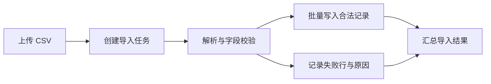

[English](README.en.md) | [中文](README.md)

# my-skills

一套面向 AI Agent 的通用 skills，提供可按需安装、独立使用的任务流程与执行约束。

## 安装

使用 `npx`：

```bash
npx skills add KomeijiReimu/my-skills
```

使用 `bunx`：

```bash
bunx skills add KomeijiReimu/my-skills
```

安装单个 skill：

```bash
npx skills add KomeijiReimu/my-skills --skill create-readme
npx skills add KomeijiReimu/my-skills --skill fkgpt-output-quality
```

安装来源：[`KomeijiReimu/my-skills`](https://github.com/KomeijiReimu/my-skills)

安装后，在支持 skills 的 Agent 中点名使用，例如：

> 用 create-readme 为这个项目重写 README，覆盖全部用户可见功能、安装步骤和典型用法。

## 按任务选择

### 输出管控

| Skill | 用途与执行方式 |
| --- | --- |
| [`fkgpt-output-quality`](fkgpt-output-quality/SKILL.md) | 从起草时禁止虚构用户立场、无关免责、回避判断、怪异黑话、流程膨胀和承诺替代执行；发送前再做内部自检，违规稿视为未完成，实际修正后才能交付。覆盖聊天回复、进度消息和文件文档。 |

这是指令级的模拟 hook，安装后需由 Agent 实际加载使用。

### 文档创作与整理

| Skill | 适合什么任务 | 交付内容 |
| --- | --- | --- |
| [`create-readme`](create-readme/SKILL.md) | 创建一个优秀、易读、覆盖全部已核实用户可见功能和关键要点的项目首页。先理解仓库，再按读者任务安排内容。 | `README.md`：用途、完整能力概览、安装与快速上手、典型用法、必要配置和重要限制。 |
| [`deliverable-document-writer`](deliverable-document-writer/SKILL.md) | 把笔记、草稿、访谈材料或审阅意见整理成可以直接提交、分享的正式文档。 | 独立可读的报告、方案或完整章节；结构围绕读者问题组织，事实、证据与结论相互对应。 |
| [`project-documentation-generator`](project-documentation-generator/SKILL.md) | 通读整个项目，把功能如何实现、模块如何协作、代码如何运行解释透彻。 | 系统级技术文档，默认如 `PROJECT_FULL_DOCUMENTATION.md`，包含实现详解、关键代码路径、配置与运行方式、Mermaid 架构和流程图。 |
| [`paper-reader`](paper-reader/SKILL.md) | 批量精读论文，逐篇完成逐句中文翻译、详尽解析或两者；持续处理全部可读论文，不因篇数多、篇幅长或已完成部分结果而提前收尾。 | 每篇独立生成 `论文名.translation.zh.md` 与／或 `论文名.analysis.zh.md`。译文忠于原文，逐句覆盖，不总结、不删减、不擅自改写；保留章节、图表、公式和附录，解析单独成文。 |
| [`project-context`](project-context/SKILL.md) | 创建、更新或审计中文项目接续资料，让下一个 Agent 能理解当前状态并继续工作。 | `.agent-context/` 中的项目地图、架构、状态、时间线、决策、风险和接手指南等 10 份核心文档。仅在当前请求明确授权时维护。 |

### 开发协作

| Skill | 用途 |
| --- | --- |
| [`git-commit`](git-commit/SKILL.md) | 分析真实 diff，按逻辑变更组织暂存，生成 Conventional Commits 格式的标题与正文并提交。 |

## 文档类 skill 的共同要求

上面 5 个文档类 skill 都针对 Agent 常见的生硬文风做了专门约束，写作和交付检查包括：

- **说清事实与动作。** 用读者能理解的语言说明做什么、怎么用、为什么；清除“证据门禁”“语义闭环”等自造黑话。项目和学科已有术语按需要解释。
- **清除无源否定和假想反驳。** 不替读者编造误解，再写一段“这不是……”“但不能说明……”来纠正。
- **成稿独立可读。** 清除聊天回应、修改备忘、自我表扬、无关免责和无意义的转折，保留真实限制、风险与证据缺口。
- **保留内容密度。** README 覆盖功能与使用要点，技术文档讲透实现，论文译文保留原文信息；语言清理不能把完整文档压成摘要，也不能改写论文的原意。
- **读回实际文件再交付。** 发现问题要改进正文并复查，不能只说“建议修改”便结束。
- **公式可渲染。** Markdown 公式使用 LaTeX，行内用 `$...$`，独立公式用单独成段的 `$$...$$`；检查符号与定界符，避免把公式写成代码或裸命令。

这些要求已分别写入文档类 skill，可独立使用。

## 看看会产出什么

以下使用虚构的文件校验工具、数据导入服务和论文片段展示结构与表达。实际章节、命令和结论以任务材料为依据。

### create-readme：打开首页，就能理解并开始使用

围绕用户的采用与使用过程组织 README，逐项展示真实功能。例如一个命令行工具：

```text
项目名称与一句话用途
├── 主要功能：输入、输出、支持的操作
├── 环境与安装
├── 快速上手：最短命令与预期结果
├── 典型用法：按真实使用场景展开
├── 配置与参数
├── 重要限制与数据处理方式
└── 深入文档入口
```

**正文片段：**

> **Hashdir** 为目录中的文件生成 SHA-256 校验清单，用于备份后的完整性核对。
>
> **主要功能**
> - 递归扫描目录，为每个文件计算校验值。
> - 将结果保存为清单，供后续复查。
> - 对比两次清单，列出新增、删除和内容变化的文件。
>
> **快速上手**
> 在 Python 3.10+ 环境中运行 `python hashdir.py ./photos --output checksums.json`，将相对路径与校验值写入清单。
>
> **复查备份**
> 运行 `python hashdir.py ./restored --compare checksums.json`，定位与原清单不一致的文件。

### deliverable-document-writer：从零散材料到可直接提交的成稿

按报告、方案或论文的读者任务安排章节；已有草稿则保持其结构、语体和论证密度。例如一份版本范围决策稿：

```text
交付目标与结论
├── 背景与问题
├── 事实和证据
├── 方案比较与选择依据
├── 实施安排与责任
└── 风险、待决事项与验收条件
```

**正文片段：**

> **版本范围**
>
> 本次发布交付批量导出与失败重试。批量导出覆盖现有的手工逐条下载流程；失败重试复用已记录的任务状态，用户可从失败位置继续。
>
> **验收条件**
>
> 导出文件应包含用户选中的全部记录。网络中断后，已完成的记录保持完成状态，重试仅处理剩余记录。

### project-documentation-generator：把实现讲到能接手维护

默认生成一份贯通全仓库的技术文档，解释功能、入口、核心模块、数据结构、处理流程和输出之间的关系。

```text
项目概览
├── 仓库结构与模块地图
├── 整体架构
├── 各项功能的实现详解
├── 核心代码路径与异常处理
├── 数据模型、状态与外部依赖
├── 配置、构建、测试与部署
├── Mermaid 架构图与流程图
└── 关键约束与维护建议
```

**正文片段：**

> **CSV 导入路径**
>
> `ImportController` 接收文件并创建导入任务。`CsvParser` 逐行解析字段，`RowValidator` 检查列数与必填项，合法记录交给 `RecordRepository` 批量写入。校验失败的记录保留行号与原因，供导入结果页展示。



### paper-reader：批量读完，逐句保真

- **整批覆盖**：为全部输入建立清单，逐篇阅读、逐篇生成所选模式的文件，核对每篇的处理状态。
- **持续处理**：不因论文数量多、内容长或已完成几篇就结束任务。单篇损坏时记录具体原因，继续处理其余可读论文；未完成项如实报告。
- **忠于原文**：逐句翻译，保留原文论点、限定、数值、术语、公式和附录，不以摘要代替全文，不擅自增删或润色。
- **翻译与解析分开**：译文对应原文，解释与评价放在独立解析文件中。

按所选模式生成两类独立文件：

```text
paper.translation.zh.md          paper.analysis.zh.md
├── 来源、标题与翻译模式         ├── 文献信息与研究问题
├── 原文章节与逐句译文           ├── 前提、符号与问题形式化
├── 图表标题、算法与公式         ├── 方法、目标函数与算法步骤
├── 附录                         ├── 实验设置、结果与消融
└── 原始参考文献条目             └── 图表解读、局限与复现线索
```

**解析片段：**

> **目标函数**
>
> 模型通过最小化均方误差拟合预测值与观测值：

$$
\mathcal{L}(\theta) = \frac{1}{n}\sum_{i=1}^{n}\bigl(f_{\theta}(x_i)-y_i\bigr)^2
$$

> 其中，$n$ 为样本数，$f_{\theta}(x_i)$ 为模型预测，$y_i$ 为观测值。每个样本的误差先平方再求平均，误差较大的样本对损失的贡献更大。

### project-context：接手时能找到入口、状态和下一步

维护固定的中文项目资料体系，将当前事实、历史变化与后续行动分别存放：

```text
.agent-context/
├── README.md             # 阅读入口与维护规则
├── current-state.md      # 当前状态与阻塞
├── project-map.md        # 目录、模块与入口
├── architecture.md       # 架构与运行方式
├── timeline.md           # 变更时间线
├── decisions.md          # 决策、原因与取舍
├── task-history.md       # 任务及其结果
├── user-preferences.md   # 用户偏好与项目约定
├── risks.md              # 风险、证据与状态
└── agent-handoff.md      # 接手顺序与后续行动
```

**接手指南片段：**

> **先读什么**：先读 `current-state.md` 确认当前阶段，再读 `project-map.md` 定位导入模块。
>
> **当前进展**：CSV 解析与字段校验已实现，失败行展示仍待完成。
>
> **继续工作**：从 `src/import/result-view.ts` 接入行号与失败原因，补充缺列和空字段场景的测试。

### 输出管控与 Git 协作示例

`fkgpt-output-quality` 按任务与证据判断一句话是否有用。例如已确认发布时间为周五：

| 候选答复 | 修正后 |
| --- | --- |
| 周五，但这不能证明未来所有版本也都周五发布。 | 周五。 |

`git-commit` 根据真实变更生成提交，例如针对 CSV 缺列处理的修改：

```text
fix(import): reject CSV rows with missing columns

Report the row number and missing fields in the import result.
```

## 目录结构

每个 skill 位于仓库根目录下的独立目录中，入口文件统一为 `SKILL.md`：

```text
fkgpt-output-quality/SKILL.md
create-readme/SKILL.md
deliverable-document-writer/SKILL.md
git-commit/SKILL.md
paper-reader/SKILL.md
project-context/SKILL.md
project-documentation-generator/SKILL.md
```

## 适用 Agent

这些 skills 可安装到支持 skills 工作流的编码 Agent，例如 OpenCode、Claude Code 和 Cursor。
